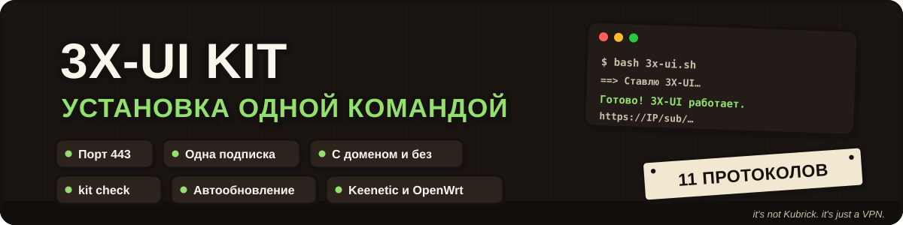
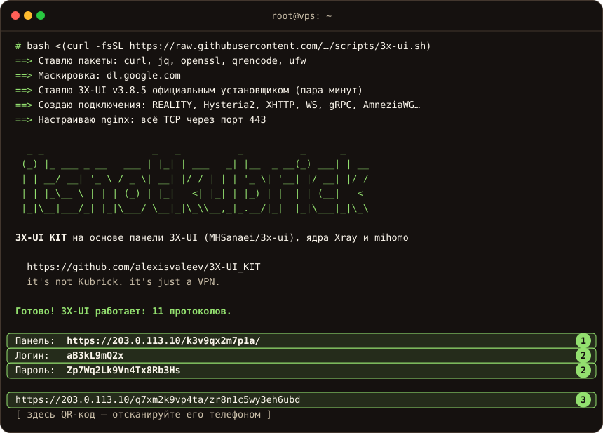

<div align="center">



**Установка 3X-UI одной командой: 11 протоколов, один порт 443, одна подписка на всё**

[](https://github.com/alexisvaleev/3X-UI_KIT/releases/latest)
[](manuals/3x-ui.md#протоколы)
[](https://github.com/alexisvaleev/3X-UI_KIT/stargazers)
[](https://github.com/alexisvaleev/3X-UI_KIT/commits)

</div>

---

> [!WARNING]
> **Проект – набор скриптов с открытым кодом.** Он не оказывает услуг связи и не предоставляет доступ
> к серверам. Вы ставите его на собственный сервер и сами отвечаете за соблюдение законодательства
> своей страны. Проект создан в образовательных целях.

**3X-UI KIT** превращает чистый VPS в готовый VPN-сервер за несколько минут. Скрипт ставит
официальную панель [3X-UI](https://github.com/MHSanaei/3x-ui), настраивает все популярные
протоколы, сертификат и файрвол и выдаёт одну ссылку-подписку. Её можно вставить в любое
приложение – оно само получит подходящие ему протоколы. Домен не нужен.

<div align="center">

</div>

## Возможности

- 🧩 **До 11 протоколов на одном порту 443.** Панель, подписка и все TCP-протоколы спрятаны за одним портом,
  а на случайный заход сервер показывает обычный сайт. Протоколы: VLESS REALITY, VLESS XHTTP + REALITY,
  VLESS WebSocket + TLS, Trojan gRPC + TLS, VMess WebSocket + TLS, Shadowsocks 2022, Hysteria2, TUIC v5,
  AmneziaWG, AmneziaWG 3.1, MTProto (прокси для Telegram). Установщик спрашивает, что ставить: «Стандарт»
  или «На выбор» по номерам, хоть один протокол.
- 🔀 **Каскад через зарубежный сервер.** Если серверов два, входной (например в РФ) отправляет весь трафик
  через зарубежный: `kit cascade export` на зарубежном, `kit cascade on` на входном – и клиенты выходят
  в интернет с зарубежного IP, ничего не перенастраивая.
- 🔗 **Одна подписка на все приложения.** Hiddify, Happ, v2rayN, Karing, Clash Verge и FlClash
  получают свой формат и только те протоколы, которые распознают.
- 🧭 **Раздельная маршрутизация.** Через VPN идут только зарубежные сервисы, остальное – напрямую.
  Правила приезжают вместе с подпиской, DNS не течёт.
- 🥷 **Маскировка.** Со своим доменом на сервере стоит ваш сайт, без него сайт подбирается среди соседей
  по подсети. REALITY работает с `xtls-rprx-vision`.
- 👥 **Пользователи во все протоколы сразу.** Один пользователь – одна подписка, общий лимит трафика,
  срок и число устройств. Меню `kit` работает как у x-ui: выбрали цифру – готово.
- 💾 **Резервная копия и переезд одной командой.** Копия сохраняет подключения, ключи и пользователей,
  а на чистом VPS (даже с другим IP) сервер поднимается из неё за минуты.
- 🔄 **Обновляется само, но только подписанными релизами.** Каждый релиз подписан ключом автора,
  сервер проверяет подпись перед обновлением.

## Что понадобится

- VPS с Ubuntu 22.04/24.04 или Debian 12/13, доступ root по SSH
- Свободные порты **443** и **80** – на свежем сервере они свободны

## Установка

```bash
bash <(curl -fsSL https://raw.githubusercontent.com/alexisvaleev/3X-UI_KIT/v1.4.0/scripts/3x-ui.sh)
```

Через пару минут скрипт покажет адрес панели, логин с паролем и ссылку-подписку.
Всё это сохраняется на сервере в `/root/3x-ui.txt`.

Подробная инструкция с картинками: [manuals/3x-ui.md](manuals/3x-ui.md).
Переход с `itsnotkubrick/3X-UI_KIT` – там же, автообновления между проектами нет (разные ключи подписи).

## Управление: меню `kit`

Команда `kit` на сервере открывает меню: пользователи, протоколы и порты, маскировка,
каскад через зарубежный сервер, проверка и починка сервера, обновления, резервные копии.
Запоминать команды не нужно – всё спрашивает само меню.

## VPN на роутере

[Инструкция для Keenetic с XKeen](manuals/xkeen-keenetic.md): раздельная маршрутизация,
только нужные устройства через VPN. А [генератор конфигов](https://alexisvaleev.github.io/3X-UI_KIT/tools/)
прямо в браузере собирает конфиги Xray, Mihomo и sing-box из ваших ссылок – ничего никуда не отправляется.

## Полезное

- [XKeen](https://github.com/jameszeroX/XKeen) и его [вики](https://github.com/jameszeroX/XKeen/wiki) – маршрутизация на Keenetic
- [IP-адреса для AmneziaWG](https://github.com/RockBlack-VPN/ip-address) – актуальные списки

Лицензия: MIT, см. [LICENSE](LICENSE). Сторонние компоненты – [NOTICE.md](NOTICE.md).
